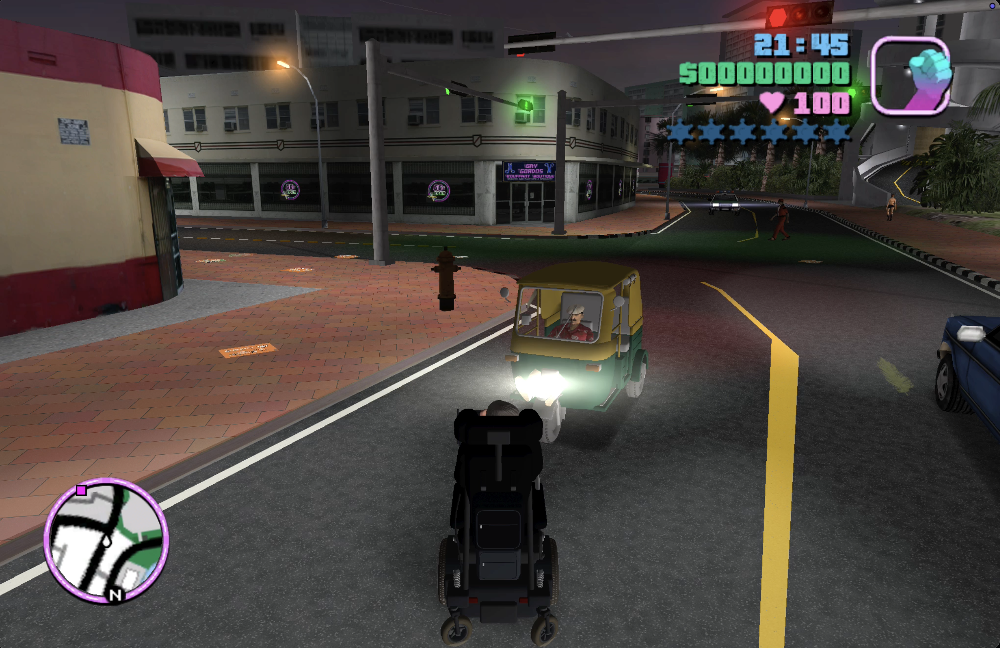
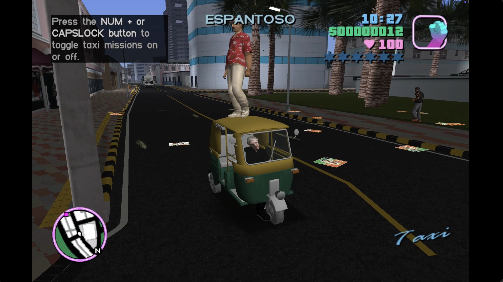
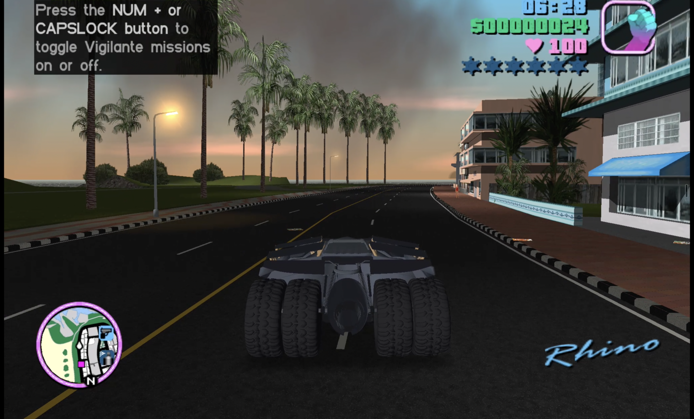
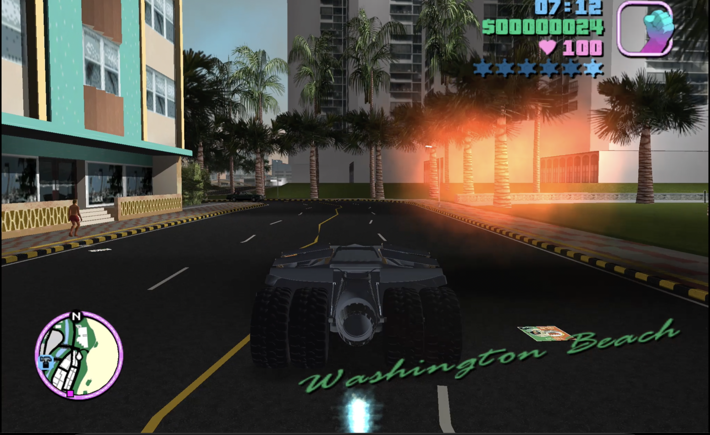

# GTA Stephen Hawking Edition

A mod for classic Grand Theft Auto: Vice City, available for Apple Silicon Macs and as a Windows preview. Drive Stephen Hawking's wheelchair, find the custom autorickshaw and bicycle, and spawn the Ambassador, Tumbler, and seven replacement vehicles.

[Mac download](#download-for-macos) · [Windows download](#download-for-windows)

## Screenshots

| Wheelchair and autorickshaw | Autorickshaw taxi |
| --- | --- |
|  |  |
| **Batmobile Tumbler on the road** | **Batmobile Tumbler boosting through Washington Beach** |
|  |  |

## Download for macOS

[Download the Mac installer (.dmg)](https://github.com/GEEGEEGOOGOO/GTA-Vice-city-Stephen-Hawking-Edition/releases/download/v1.1.0/GTA-Stephen-Hawking-Edition-Installer.dmg)

### Requirements

- An Apple Silicon Mac (M1 or newer) running macOS 26 or later.
- Your own copy of the original PC release of Vice City with matching game files. Use the macVC guide to prepare a `Grand Theft Auto Vice City.app` containing the classic game's `GameData` folder. [macVC setup guide](https://github.com/gtamac/macVC#install)
- An internet connection for the 633 MiB game download.

### Install and play

1. Double-click the downloaded **GTA-Stephen-Hawking-Edition-Installer.dmg** in Finder. In the disk image, double-click **Install GTA Stephen Hawking Edition**.
2. Confirm the classic Vice City files. The installer looks for macVC in Applications. Use **Choose Game Files…** to pick your macVC app or its **GameData** folder if needed.
3. Click **Install Mod**. The installer checks the base files, downloads the mod, and installs a playable copy in `~/Applications/GTA Stephen Hawking Edition`.
4. Click **Show Game in Finder**, open **GTA Stephen Hawking Edition.app**, then choose **Start Game → New Game**. Keep the app and its **GameData** folder together if you move the installation.

The installer is signed locally. On first launch, macOS may require you to approve it in **System Settings → Privacy & Security** after you try to open it. [Apple’s instructions for opening an unnotarized app](https://support.apple.com/en-us/102445)

## Download for Windows

[Download the Windows x64 installer (.exe)](https://github.com/GEEGEEGOOGOO/GTA-Vice-city-Stephen-Hawking-Edition/releases/download/v1.2.0-windows-preview/GTA-Stephen-Hawking-Edition-Setup-x64.exe)

Use a 64-bit Intel or AMD PC running Windows 10 or 11, an internet connection for the mod download, and your own matching copy of the original PC release of Vice City.

1. Double-click **GTA-Stephen-Hawking-Edition-Setup-x64.exe**.
2. If setup does not detect your classic Vice City installation, click **Choose Game Files…** and select the folder containing its `data` and `models` folders.
3. Click **Install Mod**. Setup checks the original files, downloads and verifies the 633 MiB game package, and creates a separate copy in `%LOCALAPPDATA%\GTA Stephen Hawking Edition`.
4. When setup finishes, click **Show Game Folder**, open **GTA Stephen Hawking Edition.exe**, then choose **Start Game → New Game**.

The preview installer is unsigned. The Windows engine and setup were cross-built, and the file assembly passed a full checksum test against compatible game data. The installer window and gameplay still need testing on a Windows PC.

## Controls and vehicles

- Use **WASD** or the **arrow keys** to drive the wheelchair. Hold **Shift** to go faster. Press **F** or **Return** to enter or exit a vehicle. See **Options → Controller Setup** for the rest of the bindings.
- Type **AMBASSADOR** during play for the Ambassador or **PANZER** for the Tumbler. The Tumbler boosts while you hold the horn and accelerate.
- Type **WAGONR**, **ALTO**, **POLO**, **MARUTI**, **GYPSY**, **FORTUNER**, or **JCB** during play for the seven-car pack.

The game stores this edition's saves and settings in
`~/Library/Application Support/Hawking Vice City/Library/Application Support/reVC`.

## Project files

- [Blender model catalog](models/README.md)
- [Build and prepare a GitHub release](docs/RELEASE.md)
- [Mac verification](docs/VERIFICATION.md)
